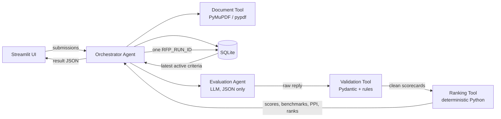
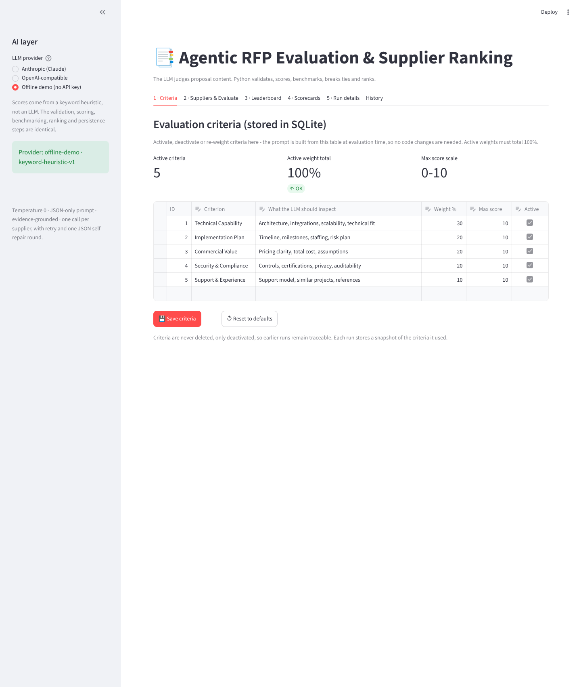
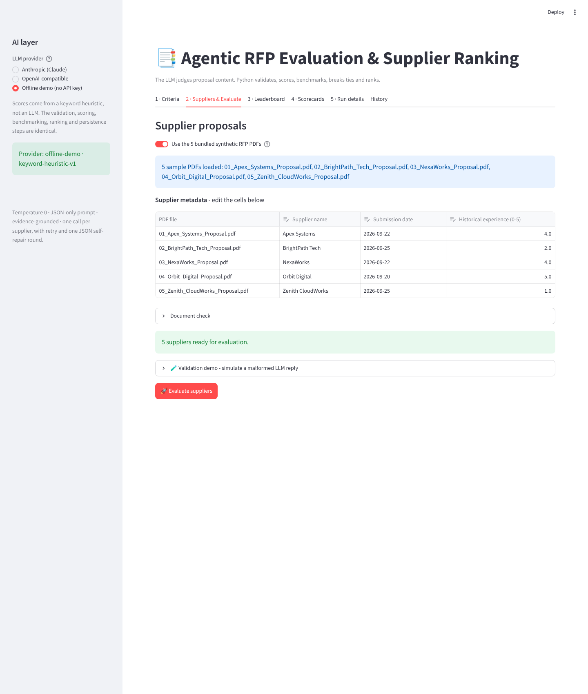
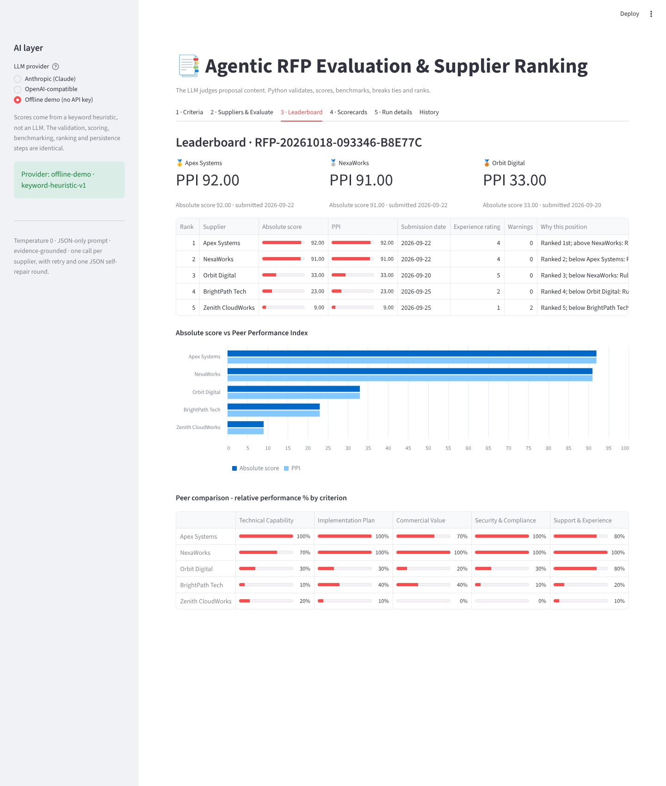
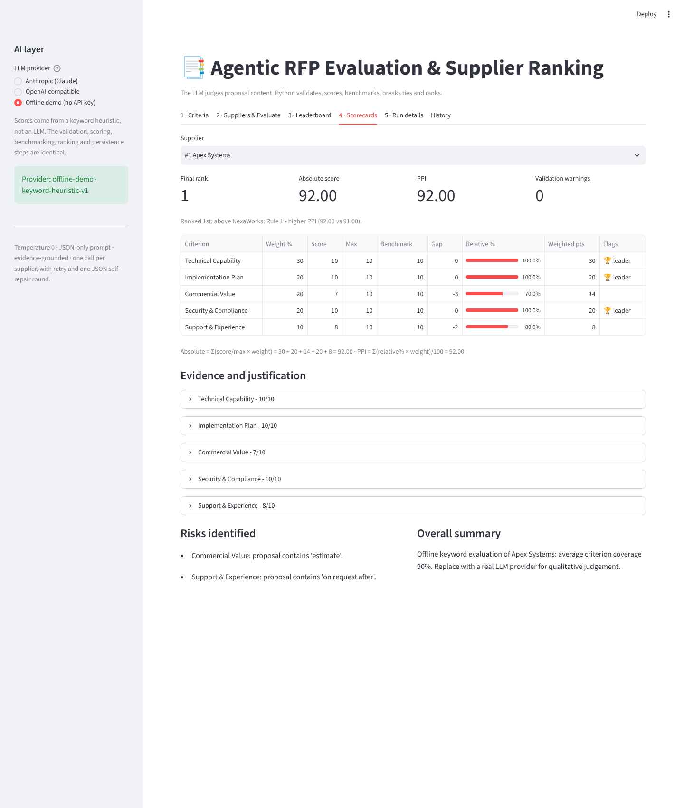
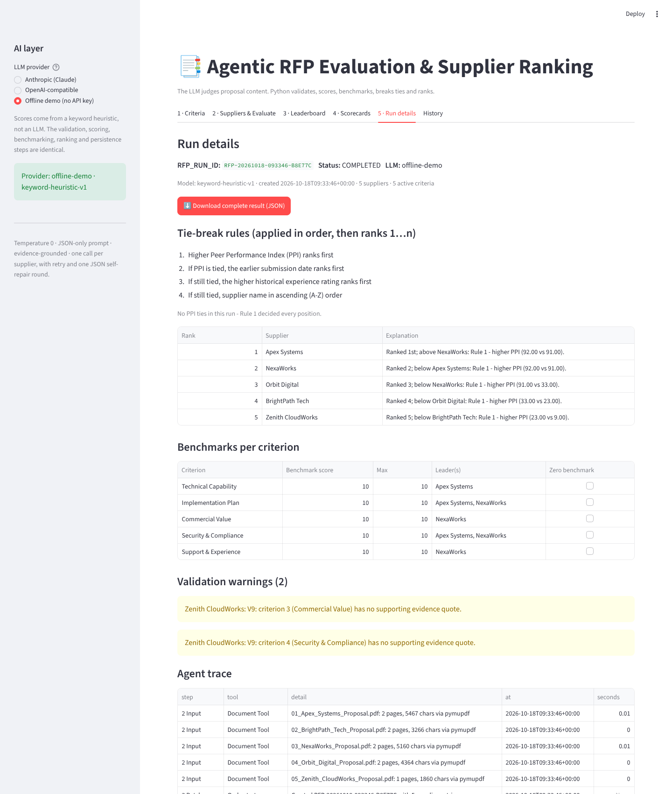
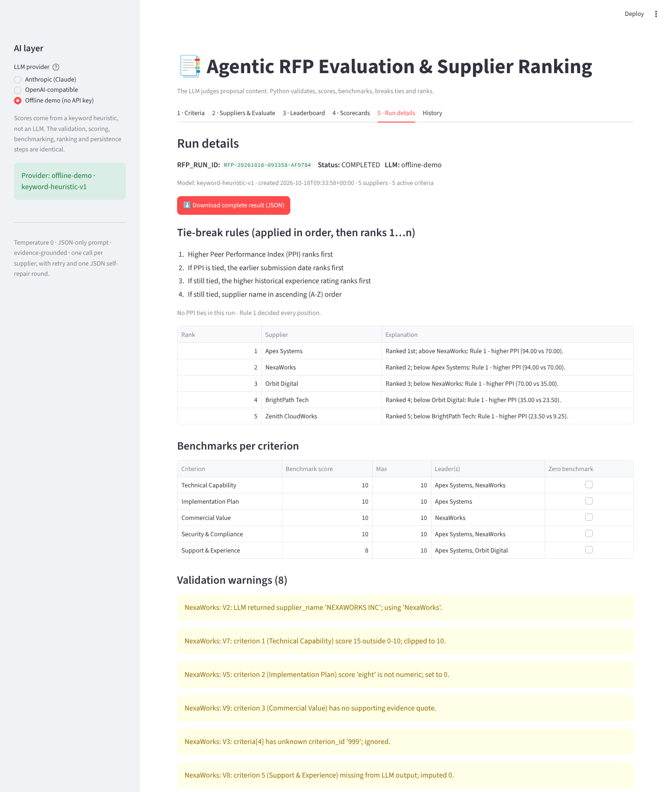

# Agentic RFP Evaluation & Supplier Ranking

An AI-assisted Streamlit application that reads supplier RFP responses (PDF), scores each one against
configurable criteria stored in SQLite, benchmarks suppliers against their peers, and produces an
explainable, deterministic leaderboard.

**Design principle:** the LLM judges proposal *content* (criterion score, justification, evidence).
It never does arithmetic, benchmarking, tie-breaks or ranking. Those come from deterministic Python,
so a validated set of scorecards always produces the same numbers and the same order.

| Layer | Technology |
|---|---|
| Application | Streamlit |
| Database | SQLite |
| AI layer | Anthropic Claude, any OpenAI-compatible LLM, or an offline demo evaluator |
| PDF extraction | PyMuPDF (pypdf fallback) |
| Validation | Pydantic plus custom rules |

---

## 1. Folder structure

```
rfp-evaluator/
├── app.py                         Streamlit UI (all screens)
├── requirements.txt               runtime dependencies (used by Streamlit Cloud)
├── requirements-dev.txt           + pytest, reportlab, playwright
├── rfp_agent/
│   ├── orchestrator.py            Orchestrator Agent - runs the 10-step workflow, records a trace
│   ├── document_tool.py           Document Tool - PDF -> clean text, readability checks
│   ├── evaluation_agent.py        Evaluation Agent - prompt + LLM providers + retry/self-repair
│   ├── validation_tool.py         Validation Tool - schema checks, normalisation, warnings
│   ├── ranking_tool.py            Ranking Tool - formulas, benchmarks, PPI, tie-breaks (pure Python)
│   ├── database.py                SQLite schema, seed data, persistence helpers
│   └── samples.py                 metadata for the bundled sample PDFs
├── db/seed.py                     database creation / seed script
├── sample_rfps/                   5 synthetic supplier proposals (PDF)
├── sample_output/
│   ├── sample_run.json            exported JSON for one completed run
│   └── sample_run_validation_case.json   run with a corrupted LLM reply (validation demo)
├── scripts/
│   ├── run_sample.py              command-line end-to-end run
│   └── generate_sample_rfps.py    regenerates the synthetic PDFs (reportlab)
├── tests/                         29 pytest tests (formulas, tie-breaks, validation, pipeline)
├── docs/
│   ├── screenshots/               UI screenshots used below
│   └── DEMO_SCRIPT.md             script for the short demonstration video
└── .streamlit/                    config.toml, secrets.toml.example
```

## 2. Setup

```bash
git clone <your-repo-url> rfp-evaluator && cd rfp-evaluator
python -m venv .venv && source .venv/bin/activate      # Windows: .venv\Scripts\activate
pip install -r requirements.txt

python db/seed.py                 # creates db/rfp_evaluation.db and seeds the 5 criteria
streamlit run app.py
```

The app also creates and seeds the database automatically on first start, so `db/seed.py` is optional.
Use `python db/seed.py --reset` to restore the default criteria.

**LLM key (optional).** Copy `.streamlit/secrets.toml.example` to `.streamlit/secrets.toml` and add
`ANTHROPIC_API_KEY` (or `OPENAI_API_KEY` + `OPENAI_MODEL` + optional `OPENAI_BASE_URL`). You can also
paste a key in the sidebar at runtime. Without a key, choose **Offline demo**. It is a deterministic
keyword evaluator that returns the same JSON contract, so every other step runs unchanged.

**Command-line run and tests**

```bash
python scripts/run_sample.py                                   # offline evaluator
python scripts/run_sample.py --provider anthropic              # needs ANTHROPIC_API_KEY
python scripts/run_sample.py --inject-fault "NexaWorks"        # validation demo
pip install -r requirements-dev.txt && pytest -q               # 29 tests
```

## 3. Deploying to Streamlit Community Cloud

1. Push this folder to a **public GitHub repository**. `.gitignore` already excludes the database and secrets.
2. Go to <https://share.streamlit.io>, choose **Create app → Deploy a public app from GitHub**.
3. Select the repo and branch, set **Main file path** to `app.py`, and pick Python 3.12 under *Advanced settings*.
4. In *Advanced settings → Secrets*, paste the contents of `secrets.toml.example` with your real key.
5. Click **Deploy**. Copy the `https://<name>.streamlit.app` URL for the submission.

Note: Community Cloud storage is ephemeral. SQLite works normally while the app is running, but stored runs
reset when the app restarts or redeploys. Criteria are re-seeded automatically.

## 4. Architecture



| Step | Component | What happens |
|---|---|---|
| 1 Setup | UI + SQLite | App starts, creates/seeds DB, shows active criteria |
| 2 Input | UI + Document Tool | Multiple PDFs uploaded (or bundled samples); metadata entered; inputs validated; every PDF extracted up front |
| 3 Batch | Orchestrator | `RFP_RUN_ID` generated; `rfp_runs` row + one `supplier_results` row per supplier (status `PENDING`) |
| 4 Evaluate | Orchestrator → Evaluation Agent | Criteria **reloaded** from SQLite; prompt built dynamically; one LLM call per supplier (temperature 0, retry, one JSON self-repair) |
| 5 Validate | Validation Tool | Parse JSON, normalise missing/malformed/out-of-range results, record warnings |
| 6 Score | Ranking Tool | Absolute weighted score |
| 7 Benchmark | Ranking Tool | Best score per criterion, gap, relative % |
| 8 Rank | Ranking Tool | PPI, 4-level tie-break, stable sort, ranks 1..n, explanation per position |
| 9 Persist | SQLite | All supplier results + full run JSON in one transaction under the run id; status `COMPLETED` (or `FAILED` with the error) |
| 10 Present | UI | Leaderboard, scorecards with evidence, run details, warnings, trace, JSON download, history |

Every run stores an **agent trace**: which tool ran, on what, how long it took, and how many LLM calls or
warnings it produced.

### SQLite schema

| Table | Columns |
|---|---|
| `evaluation_criteria` | criterion_id, name, description, weight, max_score, is_active, updated_at |
| `rfp_runs` | rfp_run_id, created_at, status, completed_at, llm_provider, llm_model, criteria_snapshot, run_json, error_message |
| `supplier_results` | id, rfp_run_id, supplier_name, source_file, submission_date, experience_rating, status, absolute_score, ppi, final_rank, result_json |

Criteria are never hard-deleted, only deactivated. Each run also keeps a snapshot of the criteria it used,
so later edits never change how an earlier result reads.

## 5. Formulas

Let `w_c` be the weight of active criterion *c* (active weights total 100), `s_c` the validated score and `m_c` its max score.

| Metric | Formula |
|---|---|
| Absolute weighted score | `Σ_c (s_c / m_c) × w_c` (0-100) |
| Criterion benchmark | `B_c = max over suppliers of s_c` |
| Criterion gap | `s_c − B_c` (0 for the leader, otherwise negative) |
| Relative performance % | `s_c / B_c × 100`; **0 when `B_c = 0`** |
| Peer Performance Index | `Σ_c (relative%_c × w_c) / Σ_c w_c` (0-100) |

**Tie-break order:** (1) higher PPI → (2) earlier submission date → (3) higher historical experience rating
→ (4) supplier name A-Z (case-insensitive). Ranks 1, 2, 3… are assigned only after this stable sort.
PPI is compared after rounding to 4 decimals so floating-point noise cannot create a false difference.

Worked example (from `tests/test_ranking.py`): supplier A scores 8, 6, 5, 9, 7 and supplier B scores 4, 8, 10, 3, 7
on weights 30/20/20/20/10. A's absolute score is 24+12+10+18+7 = **71**. Its plan benchmark is 8 (B), so A's
plan relative % is 75. A's PPI is (100·30 + 75·20 + 50·20 + 100·20 + 100·10)/100 = **85**.

## 6. Validation rules

| Code | Problem in LLM output | Normalisation |
|---|---|---|
| V1 | Not parseable JSON / `criteria` not a list | All criteria imputed as 0 |
| V2 | `supplier_name` differs from input | Input name kept |
| V3 | Unknown or missing `criterion_id` | Matched by criterion name if possible, else ignored |
| V4 | Duplicate criterion | First occurrence kept |
| V5 | Score non-numeric, null, NaN | 0 |
| V6 | LLM used a different max scale | Rescaled to the database max score |
| V7 | Score outside `[0, max]` | Clipped |
| V8 | Active criterion missing | Imputed 0 and flagged `imputed` |
| V9 | No evidence quote | Kept, flagged `evidence_missing` |
| V10 | Risks or summary wrong type | Coerced |

Code fences and text around the JSON are stripped before parsing. Every fix appears in the run's warning list
and on the supplier's scorecard.

**Input validation (before any LLM call):** at least 2 suppliers; unique non-empty names; date required and
not in the future; experience rating 0-5; each PDF must be a real PDF under 10 MB, not password-protected,
with at least 200 characters of extractable text (scanned PDFs are rejected); active criteria weights must
total 100%. If an LLM call still fails after retries, the run is marked `FAILED` with the reason. No partial
leaderboard is produced.

## 7. Assumptions

* Default scale is 0-10 per criterion. `max_score` is configurable per criterion.
* Missing criteria are scored **0**: a supplier earns no credit for something it did not address.
* A zero benchmark (no supplier scored above 0) gives every supplier 0% on that criterion. This
  does not change the order, because all suppliers are treated equally.
* Historical experience rating is entered by the evaluator on a 0-5 scale. It is used **only** as tie-break 3,
  never in the scores.
* Proposal text above 60,000 characters is truncated before prompting, and the scorecard records this.
* The prompt treats the document as untrusted data and tells the model to ignore instructions inside it.
* Determinism applies from the validated scorecards onward. LLM scores themselves can vary between calls even at
  temperature 0. That is why the run JSON stores every score, its evidence and the criteria snapshot.
* The offline demo evaluator is a transparent keyword heuristic for demonstration and testing. It is not a
  substitute for LLM judgement. In the offline demo every criterion's benchmark often reaches 10/10, which makes
  PPI equal the absolute score; with a real LLM the two usually differ.

## 8. Synthetic RFP documents

All five proposals answer the same fictional RFP (`MRG-RFP-2026-014`, an omnichannel customer-service platform for
"Meridian Retail Group"). No real supplier data is used.

| Supplier | Built-in profile | Year 1 price |
|---|---|---|
| Apex Systems | Strongest technical design and security; highest price; 24-week plan with little float | ₹2.51 Cr |
| BrightPath Tech | Cheapest and fastest; weak compliance detail; limited experience | ₹0.52 Cr |
| NexaWorks | Balanced; strongest implementation plan and support model | ₹1.63 Cr |
| Orbit Digital | Strong experience and references; vague integration plan; medium price | ₹2.02 Cr (indicative) |
| Zenith CloudWorks | **Edge case**: one page, no price, timeline, certifications or references | - |

Apex and NexaWorks share a submission date and experience rating, so a PPI tie between them would fall
through to Rule 4 (name order).

## 9. Screenshots

| | |
|---|---|
| Criteria  | Supplier input  |
| Leaderboard  | Scorecard  |
| Run details  | Validation case  |

## 10. Testing

`pytest -q` runs 29 tests:

* **Ranking:** absolute score, benchmark, gap, relative %, PPI, zero benchmark, each tie-break rule,
  PPI dominance, order-independence across 20 shuffles, weight normalisation, duplicate names.
* **Validation:** invalid JSON, fenced JSON, clipping, non-numeric scores, rescaling, missing, unknown and
  duplicate criteria, name matching, name mismatch, missing evidence.
* **Pipeline:** PDF extraction, bad files, input validation messages, full run persisted to SQLite,
  reproducibility, re-ranking from stored scorecards, fault injection, criteria changes reaching the next run,
  invalid criteria, LLM failure marking the run `FAILED`.
